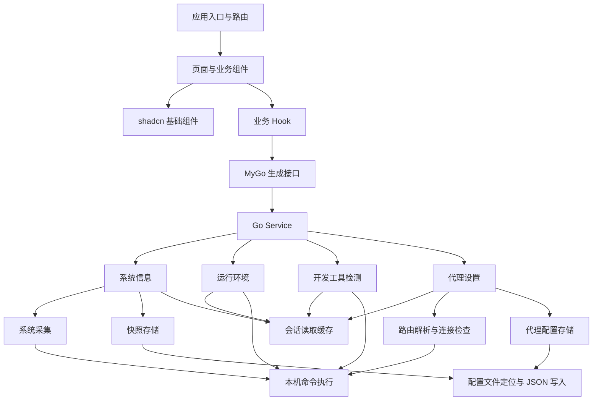

# Devbox 架构

Devbox 使用 MyGo 承载 React 界面和 Go 本机服务。前端负责展示与交互，Go 负责系统访问、业务编排和业务数据持久化，双方通过自动生成的类型化接口通信。

开发与验证遵循 [项目规则](AGENTS.md)，产品目标和待实现功能见 [产品设计](DESIGN.md)及[全局代理模块设计](PROXY_DESIGN.md)。目录入口见 [前端索引](src/index.md) 和 [后端索引](internal/index.md)。各目录的 `index.md` 记录职责及直属文件、子目录入口，通信与行为契约集中在本文。

## 入口与职责

| 位置 | 职责 |
| --- | --- |
| [main.go](main.go) | 分派系统代理查询子命令，注册 Go 服务、创建窗口并启动 MyGo 应用 |
| [mygo.config.ts](mygo.config.ts) | 配置前端开发地址、构建命令、产物和接口生成路径 |
| [src/main.tsx](src/main.tsx) | 恢复上次路由，挂载 React、StrictMode、HashRouter 和浮动提示 |
| [src/app.tsx](src/app.tsx) | 将合法路由映射为页面，组合应用外壳、导航和页面 |
| [src/app-routes.ts](src/app-routes.ts) | 定义路由及标题，校验路径，保存与恢复上次页面 |
| [src/features](src/features/index.md) | 按业务组织页面、组件、Hook 和业务内工具 |
| [src/features/runtime-env](src/features/runtime-env/index.md) | 概览页的运行环境展示 |
| [src/features/devtools](src/features/devtools/index.md) | 工具目录、检测卡片与安装详情 |
| [src/features/settings](src/features/settings/index.md) | 代理设置、配置恢复和连接检查 |
| [src/components/ui](src/components/ui/index.md) | shadcn 基础组件，由业务组件组合使用 |
| [src/lib](src/lib/index.md) | 已被复用的通用前端工具 |
| [src/mygo.ts](src/mygo.ts) | MyGo 生成的 TypeScript 类型与服务调用入口 |
| [internal/systeminfo](internal/systeminfo/index.md) | 当前的系统信息业务，包括采集、快照存储与服务编排 |
| [internal/runtimeenv](internal/runtimeenv/index.md) | 用户主目录和默认登录 Shell 查询 |
| [internal/devtools](internal/devtools/index.md) | 本机开发工具检测 |
| [internal/proxy](internal/proxy/index.md) | 代理配置、路由解析和连接检查 |
| [internal/configfile](internal/configfile/index.md) | 配置文件定位和 JSON 写入 |
| [internal/localcmd](internal/localcmd/index.md) | 本机短命令执行和子进程取消 |
| [internal/readcache](internal/readcache/index.md) | 同项读取协调与会话内结果复用 |

应用外壳通过属性接收侧栏、面包屑和页面内容。页面组合业务组件；导航组织入口与路由信息。新增业务沿用 `src/features/<业务>` 和 `internal/<业务>` 的组织方式。

## 模块边界与依赖方向



- 页面负责组合刷新入口，卡片负责展示。[use-refreshable.ts](src/hooks/use-refreshable.ts) 协调系统信息、运行环境和开发工具的首次读取、手动刷新与取消。设置表单管理独立的读取、写入和连接检查。
- Go Service 组合具体采集与存储能力，负责业务顺序、超时和错误处理。被绑定服务的导出方法属于前端可调用契约。
- 采集模块负责系统接口与平台命令，存储模块负责文件格式与读写，二者通过数据模型协作。
- [localcmd](internal/localcmd/index.md) 执行短命令并管理子进程，业务模块指定命令、环境与截止时间。Windows 的显卡和磁盘采集共用 PowerShell JSON 查询入口。
- Go 业务服务持有各自的缓存。[readcache](internal/readcache/index.md) 复用最近成功的读取结果，协调同一项的并发读取。业务服务决定有效期与主动刷新的语义。
- 业务界面通过 shadcn 组件和内置变体组合。业务内的格式化和请求逻辑位于所属业务目录。
- 当前采用具体函数组合。公共模块与接口的提取以实际复用、替换实现或依赖解耦需求为依据。

## 通信与执行方式

### 当前通信入口

Go 在 `main.go` 中注册系统信息服务 `SystemService`、运行环境服务 `EnvironmentService`、开发工具服务 `DevToolsService` 和代理设置服务 `ProxyService`。业务 Hook 通过 `src/mygo.ts` 中生成的接口调用它们。

`src/mygo.ts` 是生成产物，类型与方法签名以 Go 定义为源。修改 Go 对外契约后运行 `bun run generate`，同步调整调用方并检查类型。前端共用生成类型与调用入口。

MyGo 接口生成会执行应用入口直到 `App.Run`。入口中保持服务注册和应用组装；需要读写业务数据的初始化工作放在适当的应用生命周期或业务调用中。

### 同步与异步

前端调用返回 Promise，通过 `await` 等待结果，界面仍可响应。每次 MyGo 绑定调用在独立 goroutine 中执行；Go 服务内部按业务顺序执行，只有独立工作才并行。

概览和开发工具的缓存读取与重新采集共用普通调用。概览的统一刷新发起独立请求，各卡片随各自的结果更新。Go 在系统信息采集中并行查询 GPU 和磁盘。

普通调用是当前默认方式；Channel、Event 和后台任务在出现对应需求时按下表引入。

| 实际需求 | 通信与生命周期约定 |
| --- | --- |
| 查询数据、保存配置、执行一次操作 | 普通调用返回结果或错误；明确成功是否包含持久化完成 |
| 单次调用持续产生日志、输出或进度 | 使用 MyGo Channel，随该次调用结束或取消 |
| 数据变化需要通知其他监听者或窗口 | 使用类型化 Event 通知变化，由所属业务协调查询与状态更新 |
| 页面离开后仍需运行的安装、构建等任务 | 由 Go 管理任务生命周期，启动返回任务标识，并提供状态查询和显式取消 |

通信方式与任务形式按输出形式、取消方式和任务与页面的生命周期关系选择。

### 取消、错误与并发

- 页面内的读取和连接检查使用 `AbortController`。刷新会取消同一项的旧请求，离开页面会取消关联读取。代理保存和恢复继续执行，完成后通过全局通知反馈。
- Go 耗时调用接收 `context.Context`，并传给支持取消的系统接口、外部命令和网络操作。每项采集由业务服务设置期限，等待同项缓存读取时也可取消。
- Go 返回的错误使前端 Promise 拒绝。Hook 将其转换为界面状态，组件展示提示并提供重试；取消的请求保持安静。
- 多个 MyGo 调用可以同时执行。同项快照读取、重新采集和保存串行执行，不同数据项可并行。文件使用临时文件写入后替换。
- `ProxyService` 持有代理配置，用互斥锁协调读取、保存与恢复。连接检查使用每次调用传入的表单草稿。

## 状态与持久化归属

| 数据 | 归属与保存方式 |
| --- | --- |
| 系统信息 | 本机采集为数据来源，`SystemService` 保留本次运行中最近一次采集结果，文件快照供下次启动读取 |
| 当前展示的快照、刷新中和错误 | 查询 Hook 的 React 内存状态 |
| 运行环境 | `EnvironmentService` 的会话内结果，由概览统一刷新 |
| 开发工具检测结果 | `DevToolsService` 的会话内结果，按工具单独刷新 |
| 代理设置 | `ProxyService` 和 `os.UserConfigDir()/devbox/proxy.json` |
| 系统代理展示结果 | `ProxyService` 的 30 秒内存缓存 |
| 代理表单草稿和连接检查状态 | 设置页面的 React 内存状态 |
| 主题、侧栏展开状态、上次页面 | 前端 `localStorage`，分别由主题、外壳和路由模块管理 |

业务数据的存储格式、兼容性和采集策略由 Go 管理。前端本地存储用于界面偏好。主题在 [index.html](index.html) 中先恢复，再由主题模块切换；调整主题存储约定时需要同时核对这两个入口。

## 系统信息模块

### 后端组成

| 文件 | 职责 |
| --- | --- |
| [model.go](internal/systeminfo/model.go) | 定义 `SystemInfo`、`GPUInfo` 和带采集时间的 `SystemSnapshot` |
| [service.go](internal/systeminfo/service.go) | 提供 `Get`，协调内存、文件快照和重新采集 |
| [collector.go](internal/systeminfo/collector.go) | 采集本机数据，协调独立的 GPU、磁盘查询 |
| [snapshot_store.go](internal/systeminfo/snapshot_store.go) | 解析文件位置、读取和校验快照、写入并替换快照文件 |
| `graphics_<平台>.go` | 通过对应平台的系统命令读取 GPU 信息 |
| `storage_<平台>.go` | 读取物理磁盘总容量，按整块磁盘计数；此处的 storage 指磁盘采集 |

一次系统采集的预算为五秒，其中并行的 GPU 和磁盘查询各有三秒预算。可选项失败或超时仍保留其他字段。数值缺失为 `null`，GPU 列表缺失归一化为 `[]`。整体采集取消或超时时返回错误。

### 接口契约

| 前端调用 | 成功返回 | 行为与错误 |
| --- | --- | --- |
| `SystemService.get(false)` | `SystemSnapshot` | 依次使用内存快照、兼容的文件快照和本机采集。文件读取失败时记录日志并采集 |
| `SystemService.get(true)` | `SystemSnapshot` | 重新采集并更新快照。采集失败时保留已有快照，文件保存失败时记录日志并返回本次结果 |

`SystemSnapshot` 包含 `info` 和 `collectedAt`。`collectedAt` 是采集完成的 UTC 时间，经生成接口表示为字符串。

### 页面加载与刷新

[概览页](src/features/workspace/workspace-page.tsx) 分别读取系统信息和运行环境。一个“刷新概览”按钮触发两项独立查询，各卡片按各自的完成或失败状态更新。首次读取期间显示占位，刷新期间保留已有数据。离开页面时取消两项读取。

### 快照文件

文件位置为 `os.UserConfigDir()/devbox/system-info.json`，macOS 对应 `~/Library/Application Support/devbox/system-info.json`。

当前文件格式版本为 `2`，包含 `version`、`info` 和 `collectedAt`。读取时校验版本、采集时间非零、操作系统和架构，额外的 JSON 字段会被忽略。旧格式或不兼容快照会在下次成功采集并写入后被替换。快照和代理设置通过 `configfile` 定位文件并写入同目录临时文件，完成编码和关闭后再替换目标文件。

## 运行环境

概览页在系统信息右侧显示[运行环境卡片](src/features/runtime-env/environment-card.tsx)，内容较窄时改为纵向排列。`EnvironmentService.get(false)` 使用本次运行中的结果，首次读取时查询用户主目录和默认登录 Shell。刷新概览时调用 `get(true)` 重新读取。

`homeDir` 由 Go 的 `os.UserHomeDir` 读取，桌面端取自进程的 `HOME` 或 `USERPROFILE`。在 macOS 和 Linux 上，`loginShell` 通过 UID 查询系统账号，分别调用 `/usr/bin/dscacheutil` 和 `/usr/bin/getent`。查询期限为两秒。主目录缺失、默认登录 Shell 查询失败或平台不适用时，对应字段为空，页面显示“暂不可用”。

## 开发工具检测

前端的[工具目录](src/features/devtools/tool-catalog.ts) 定义开发工具页的分组、工具标识、名称、检测方法和展示范围。分组按主要用途和语言生态划分，平台限制按工具条目声明。前端通过 MyGo 运行时读取平台，隐藏无适用工具的分组。Go 检测服务负责平台校验和命令定位。

| 开发工具分组 | 当前工具 |
| --- | --- |
| 系统包管理器 | macOS 上的 Homebrew |
| 基础工具 | Git、GitHub CLI、jq、ripgrep |
| Python | Python、uv |
| JavaScript | Node.js、npm、pnpm |
| Shell 与脚本 | macOS 和 Linux 上的 Zsh，Windows 上的 PowerShell |

开发工具按组展示卡片，每组每排最多四张，卡片平分所在行的可用宽度。系统包管理器和 Shell 与脚本同时适用时在页面顶部并排，内容区较窄时上下排列。[工具卡片](src/features/devtools/tool-card.tsx) 通过 [DevToolsService](src/mygo.ts) 中各自的检测方法读取结果。进入页面时优先使用最近一次检测结果，首次读取时执行检测。卡片的刷新图标只重新查询对应工具。开始同一工具的新请求或离开页面时取消旧请求。

Go 在 [devtools](internal/devtools/index.md) 内共用 `ToolDetection`、命令查找和命令执行。[发现与编排](internal/devtools/discovery.go) 按 Devbox 进程的 `PATH` 顺序收集绝对目录中的入口，再加入工具特有的路径。每项检测最多并行探测四个入口，按发现顺序返回 `ToolDetection[]`。单个入口的失败随结果返回。相同入口只探测一次，指向同一实际路径且版本相同的成功结果只显示首次命中的一条。Python 按探测返回的解释器路径区分环境。

卡片以首个可用结果作为摘要，全部不可用时显示首条结果。标题行显示工具名称、可用版本和操作，名称提示包含工具说明和完整版本。可用时内容行并排显示已识别的安装来源和路径，未找到时显示状态，有已知入口时可在状态提示中查看路径。有多条检测结果时，点击刷新图标旁的数字可打开安装详情。详情按检测顺序列出各条结果，成功条目显示完整版本和已识别的来源，失败条目显示原因。有路径的条目在空间不足时单行截断，悬浮或键盘聚焦可查看完整路径。卡片的路径行沿用同样的展示方式。

Go 根据已知位置及解析符号链接后的实际路径识别来源。[通用来源判定](internal/devtools/source.go) 支持 macOS 系统命令、Apple 开发工具和 Homebrew 默认 Cellar。Windows PowerShell 的系统入口标注为系统自带。Python 按基础解释器归属标注来源，虚拟环境的路径与独立结果保留。Node.js 无法归属时显示「未知」，其他工具在来源字段为空时省略来源。

每项检测有六秒预算，单条命令最多运行五秒。查找入口阶段超时会返回整项错误。探测阶段超时时保留已取得的结果，等待中的入口标为尚未探测。调用方取消时停止探测。Unix 终止命令所在的进程组，Windows 终止命令所在的 Job Object。Windows 后台命令使用无控制台窗口模式。成功结果中的路径来自实际执行的入口或解释器。

- [Git](internal/devtools/git.go) 使用 `PATH` 中的绝对入口。在 macOS 上，入口解析为 `/usr/bin/git` 时，通过 `xcode-select --print-path` 查找当前开发工具目录，直接执行其中的 `usr/bin/git`，避免触发安装提示。
- [jq、ripgrep 和 GitHub CLI](internal/devtools/utilities.go) 分别查找 `jq`、`rg` 和 `gh` 并执行 `--version`。macOS 上还检查 `/opt/homebrew/bin` 和 `/usr/local/bin`。GitHub CLI 检测关闭版本更新检查。
- [Zsh](internal/devtools/zsh.go) 在 macOS 和 Linux 上执行 `zsh --version`。应用 `PATH` 之后检查 macOS 的常用包管理器路径以及 `/bin/zsh` 和 `/usr/bin/zsh`。
- [PowerShell](internal/devtools/powershell.go) 在 Windows 上查找 `pwsh`，并检查 PowerShell 7 和系统自带 Windows PowerShell 的默认安装路径。探测在不加载用户配置的非交互会话中读取 `$PSVersionTable.PSVersion`。
- [uv](internal/devtools/uv.go) 使用 `PATH` 中的绝对入口并执行 `uv --version`。
- [Python](internal/devtools/python.go) 在 macOS 和 Linux 上查找 `python3`，在 Windows 上查找 `python.exe`。macOS 的 `/usr/bin/python3` 与 Git 共用 Apple 开发工具目录查询。Windows 的应用执行别名通过 `pymanager.exe list --one --format=json` 查询已安装解释器，探测为子进程关闭自动安装选项。探测在隔离模式中读取版本、当前解释器路径及可用的基础解释器路径，并识别 uv 的默认数据目录或 `UV_PYTHON_INSTALL_DIR` 中的解释器。
- [Homebrew](internal/devtools/homebrew.go) 在 macOS 上检测。`PATH` 入口之后，按应用进程架构检查 `/opt/homebrew/bin/brew` 和 `/usr/local/bin/brew`。
- [Node.js](internal/devtools/node.go) 与 npm 共用已知版本目录的查找和来源识别。先查应用 `PATH`，再查 macOS 常用安装路径以及 Homebrew 默认 Cellar 的 `node` 与 `node@*`、fnm 的 `node-versions`、nvm 的 `versions/node` 和 nvm-windows 安装目录。同一实际路径和版本经多个入口命中时，保留最先发现的入口。
- [npm 和 pnpm](internal/devtools/javascript.go) 执行 `--version`，优先使用入口同目录下的 Node.js。npm 与 Node.js 共用版本目录查找，pnpm 补查 macOS 常用安装路径和绝对路径 `PNPM_HOME`。Corepack 探测关闭联网、下载提示和项目版本选择，使用已配置或内置的默认版本。成功结果的入口解析到 Corepack 脚本时标注来源。Corepack 因离线而无法获取默认版本时，返回 `failed`、入口路径和 `corepack` 来源，提示先安装所需版本再刷新。pnpm 自身的按项目切换版本也在探测时关闭。Windows 上通过系统 `cmd.exe` 执行 `npm.cmd` 和 `pnpm.cmd` 等批处理入口，其子进程纳入同一个 Job Object。

| `status` | 含义 |
| --- | --- |
| `available` | 命令成功并返回可识别的版本，包含 `path` 和 `version` |
| `not_found` | 在查找范围内未找到入口，或从已知的 Python 启动别名未找到已安装解释器，包含 `message` |
| `failed` | 入口无法使用、命令执行失败或超时、版本格式未识别，或探测因整项期限尚未开始，包含 `message` 及已知的 `path` |
| `unsupported` | 当前平台不适用该项检测，包含 `message` |

未找到入口或平台不适用时，数组包含一条对应状态。检测结果保存在 Go 进程内。刷新期间显示上次结果，收到新结果后更新对应卡片。请求失败时保留上次结果并提示重试。一次请求失败只影响对应卡片。

## 代理设置

设置页通过 [use-proxy-settings.ts](src/features/settings/use-proxy-settings.ts) 管理表单，使用 [proxy-settings-card.tsx](src/features/settings/proxy-settings-card.tsx) 展示代理模式。默认系统代理；手动模式选择 `127.0.0.1:7890`、`127.0.0.1:7897` 或自定义主机与端口，HTTP 和 SOCKS5 使用同一个地址。代理地址不包含认证信息。

保存、恢复和连接检查通过浮动提示报告结果。保存和恢复完成后反馈写入结果，切回设置页时等待进行中的写入结束再读配置。[系统代理状态](src/features/settings/use-system-proxy.ts) 在系统模式显示时及窗口聚焦时读取，Go 复用 30 秒内的展示结果。系统代理刷新期间保留上次读取结果。系统配置和访问 `example.com` 的实际路由在同一个三列网格中展示。后端返回配置类型、路由状态、协议和去掉认证信息的地址。前端按这些字段合并重复项并生成中文标签。macOS 上有自动配置时单独列出实际路由。其他平台展示实际路由。

| 前端调用 | 行为 |
| --- | --- |
| `ProxyService.get()` | 返回已保存设置。文件缺失时返回默认值，文件内容无效或版本不兼容时返回 `null`，其他读取错误拒绝 |
| `ProxyService.getSystemInfo()` | 返回 30 秒内的结果，过期时读取系统配置和示例路由。取消可终止 macOS 配置查询和子进程路由查询。进程内的 MyGo 平台解析会继续到返回 |
| `ProxyService.save(settings)` | 验证并保存设置，成功后更新服务状态。非手动模式保留上次的手动地址 |
| `ProxyService.reset()` | 用系统模式和 `127.0.0.1:7890` 替换设置文件，成功后返回默认设置 |
| `ProxyService.check(settings)` | 用草稿对 `https://example.com/` 发起 HEAD 请求，成功时返回 `void`。请求使用十秒截止时间，可取消手动探测、子进程路由查询和网络请求 |

代理配置保存在 `os.UserConfigDir()/devbox/proxy.json`，当前格式版本为 `1`。设置页识别无效文件后提供恢复默认设置操作。保存或恢复失败时保留当前配置。服务首次读取或保存时加载配置，服务注册和接口生成期间无需读取。

连接检查是当前唯一的代理网络操作。手动代理客户端首次请求通过 SOCKS5 握手识别所选地址，未识别到无认证 SOCKS5 时使用 HTTP，探测结果由客户端复用。系统和手动模式都绕过本机回环地址。连接检查在 HTTP `CONNECT` 阶段识别代理认证错误。

实际路由展示和连接检查共用系统代理解析。启动环境中的 `HTTP_PROXY`、`HTTPS_PROXY` 各自优先，`ALL_PROXY` 填补缺少的协议配置，`NO_PROXY` 匹配的目标直连。请求协议没有环境代理时，交由 MyGo 的 `netproxy.Proxy` 按平台解析。没有代理环境变量时，MyGo 在应用进程内按协议和主机缓存结果五秒。存在代理环境变量时，桌面端通过不继承这些变量的短命令读取系统路由，最长等待六秒。MyGo 返回空路由时直连。macOS 系统配置使用 `scutil --proxy` 读取。外部进程的代理适配见[代理设计](PROXY_DESIGN.md)。

## 修改与验证

功能修改先追踪页面、Hook、生成接口、Go Service 和具体能力的调用链。改变接口时同步处理 Go 定义、生成文件和全部调用方；改变文件格式时同步处理版本、读取规则和写入规则。

涉及职责划分、依赖方向、对外接口、状态归属、存储或生命周期的改动，需要同步更新本文。各章节记录当前实现，演进约定说明适用条件；代码、生成接口与文档保持一致。

按改动范围选择验证命令：

```sh
bun run generate
bun run build:web
CGO_ENABLED=0 go vet ./...
CGO_ENABLED=0 go build -o ./build/devbox .
git diff --check
```

`build:web` 包含 TypeScript 类型检查。上述检查覆盖接口生成、类型、静态检查和构建；界面交互与平台实际表现按项目规则另行验证。仅修改文档时，核对描述与源码、相对链接及 `AGENTS.md` 的文档入口。
